# Znit.io, Landing Page

Landing page do ecossistema de bots de trading da Znit: market making, arbitragem simples e arbitragem triangular em exchanges centralizadas (Binance, OKX, Bybit, Coinbase e Bitfinex). É uma página de uma só rota por idioma, com visual cyberpunk, cenas em canvas, seções que "empilham" no scroll e conteúdo em 8 idiomas.

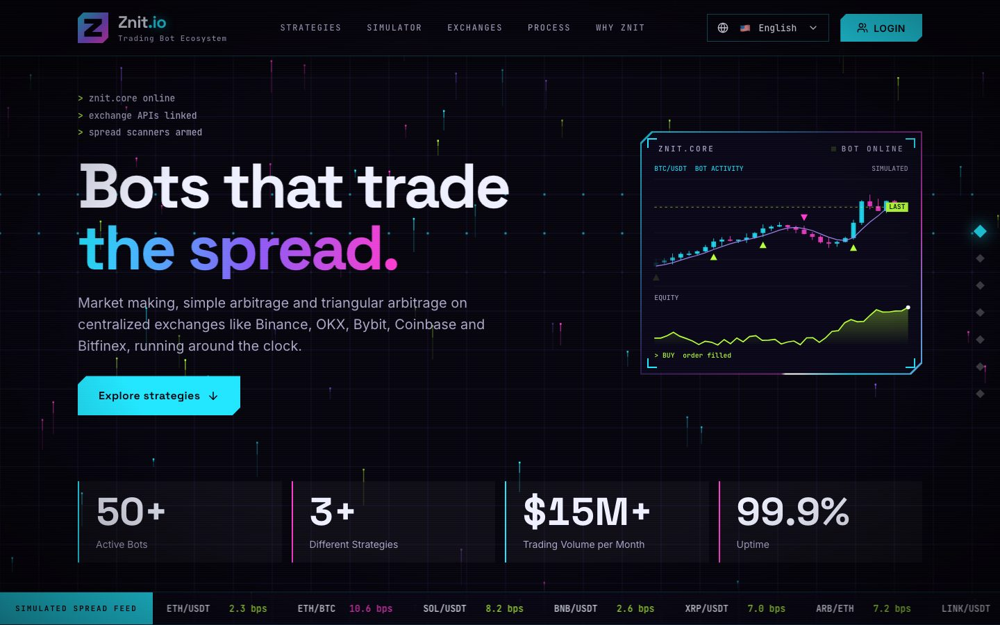

Este documento serve de guia para quem vai trabalhar na página: como rodar, como o código está organizado, quais padrões seguir e como fazer as alterações mais comuns.

## Sumário

1. [Stack](#stack)
2. [Como rodar](#como-rodar)
3. [Estrutura do projeto](#estrutura-do-projeto)
4. [Tour pela página](#tour-pela-página)
5. [Versão mobile](#versão-mobile)
6. [Sistema de design](#sistema-de-design)
7. [Animação e performance](#animação-e-performance)
8. [Internacionalização](#internacionalização)
9. [SEO](#seo)
10. [Rotas, login e dashboard](#rotas-login-e-dashboard)
11. [Receitas](#receitas)
12. [Testar visualmente](#testar-visualmente)
13. [Convenções e cuidados](#convenções-e-cuidados)
14. [Deploy](#deploy)
15. [Documentos relacionados](#documentos-relacionados)

## Stack

| Área | Tecnologia |
| --- | --- |
| Base | Create React App com CRACO (`craco.config.js`), React 19, TypeScript (strict) |
| Rotas | react-router-dom 7, uma rota por idioma |
| Estilo | Tailwind 3 + CSS próprio (`landing.css`, `nav.css`, `App.css`) |
| Fontes | Space Grotesk (títulos), Inter (texto), JetBrains Mono (dados e rótulos) |
| Animação | Canvas 2D, CSS (`@property`, `conic-gradient`, `clip-path`) e `requestAnimationFrame`, sem biblioteca de animação |
| Auth | AWS Amplify / Cognito (somente o botão de login e o seletor de dashboards) |
| Build | `craco build` seguido de `node scripts/seo.cjs` |
| Deploy | Netlify (`netlify.toml`) |

Gerenciador de pacotes: **yarn** (`packageManager` no `package.json`, `yarn.lock` versionado).

## Como rodar

```bash
yarn install
yarn start                 # http://localhost:3000
PORT=3002 yarn start       # porta usada no fluxo local com os outros apps (veja LOCAL_ENVIRONMENT_FLOW.md)
yarn build                 # gera build/ + páginas por idioma + robots.txt + sitemap.xml
npx tsc --noEmit -p .      # checagem de tipos, rode antes de abrir PR
```

Variáveis de ambiente (arquivo `.env`, modelo em `env.txt`):

| Variável | Uso |
| --- | --- |
| `REACT_APP_COGNITO_USER_POOL_ID`, `REACT_APP_COGNITO_APP_CLIENT_ID`, `REACT_APP_COGNITO_DOMAIN`, `REACT_APP_COGNITO_REDIRECT_SIGN_IN`, `REACT_APP_COGNITO_REDIRECT_SIGN_OUT` | Login via Cognito (`src/amplifyConfig.ts`) |
| `REACT_APP_BACKEND_URL` | URL do backend |
| `SITE_URL` ou `REACT_APP_SITE_URL` | Endereço público para canonical, hreflang, sitemap e robots (padrão `https://znit.io`) |
| `DISABLE_HOT_RELOAD=true` | Desliga o hot reload (útil se algo recarregar a página durante testes) |

A landing em si não precisa de nenhuma variável para renderizar. Sem as do Cognito, só o login não funciona.

## Estrutura do projeto

```
landing-page/
  public/                  index.html, favicons, og-image.png, robots.txt
  scripts/
    seo.cjs                pós-build: HTML por idioma, meta tags, JSON-LD, robots.txt
    shared.cjs             SITE e loader de TS usado pelo build e pelo craco
  craco.config.js          alias @, sitemap.xml (apenas em produção)
  netlify.toml             build, fallback de SPA e X-Robots-Tag
  docs/screenshots/        imagens deste README
  src/
    App.tsx                BrowserRouter, navegação, rotas por idioma, login
    nav.css, App.css       barra de navegação e estilos globais
    landing.css            TODO o estilo da landing (tokens, seções, mobile)
    components/
      LandingPage.tsx      composição das seções e loop de scroll
      CyberBackground.tsx  fundo fixo: malha, poço gravitacional, ticks
      Footer.tsx, Login.tsx, DashboardSelector.tsx, LanguageSelector.tsx
      brand/ZMark.tsx      logotipo (Z)
      landing/
        HeroBot.tsx        gráfico de velas do hero (ZNIT.CORE)
        Manifesto.tsx      texto que acende palavra por palavra
        BlackHole.tsx      buraco negro em canvas
        Diagrams.tsx       reexporta as 4 cenas das estratégias
        MarketMakerScene.tsx, ArbitrageScene.tsx, TriangularArb.tsx, NeuralScene.tsx
        scene.tsx          casca comum das cenas (escala, pausa, movimento reduzido)
        Simulator.tsx      simulador de ciclo triangular
        Venues.tsx         cena "Onde nossos bots operam"
        fx.tsx             Scramble, Counter, useReveal, useInView, reducedMotion
      ui/                  componentes shadcn/Radix (usados fora da landing)
    lib/lens.ts            cometa que acompanha o mouse nos painéis
    i18n/                  translations.ts, locales.ts, LanguageContext.tsx, types.ts
    contexts/AuthProvider.tsx
```

`graphify-out/` (grafo de conhecimento do código) é gerado localmente e está no `.gitignore`.

## Tour pela página

A página tem sete seções, na ordem: `top`, `strategies`, `simulator`, `venues`, `process`, `why`, `start`. Elas estão em `LandingPage.tsx` (constante `SECTIONS`) e o menu e a trilha lateral usam esses ids.

### 1. Hero e ZNIT.CORE

Título, descrição, botão e um painel com velas simuladas, marcas de compra e venda e curva de equity (`HeroBot.tsx`). Logo abaixo ficam os números (`Counter`) e a faixa de spreads em bps (`Tape`).

### 2. Manifesto e buraco negro

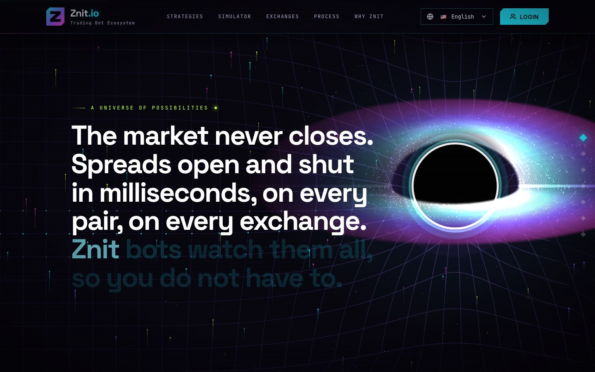

Seção fixada (sticky) em que o texto acende palavra por palavra conforme o scroll (`Manifesto.tsx`, variável CSS `--mp`). Atrás dele, `BlackHole.tsx` desenha horizonte de eventos, anel de fótons, disco de acreção e lente gravitacional. O buraco negro também deforma a malha do fundo: ele publica sua posição e raio no objeto `mass` (em `src/lib/wells.ts`, reexportado por `CyberBackground.tsx`), e a malha se curva em torno dele. Os cometas em voo também são atraídos pelo buraco negro: eles curvam a trajetória, aceleram, somem no horizonte e, ao serem engolidos, o disco dá um clarão. Depois de alguns ticks livres, o usuário precisa clicar para alimentar o buraco negro.

### 3. Estratégias (palco fixo)

Uma única seção alta (`.strat`) com um palco `sticky`. O scroll troca o capítulo ativo (texto à esquerda, cena à direita). Cada cena é um canvas desenhado em um espaço de 480 x 360.

| 1. Market making | 2. Arbitragem simples |
| --- | --- |
| 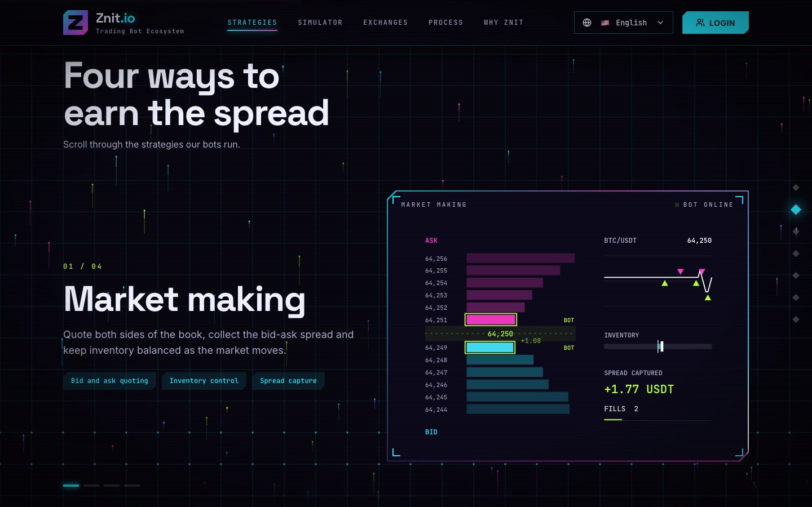 | 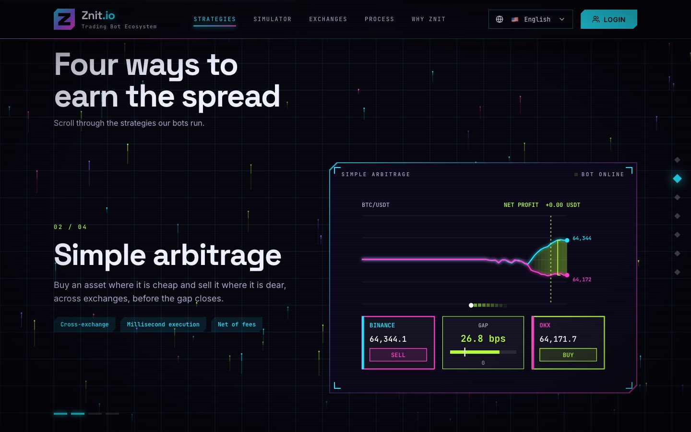 |
| **3. Arbitragem triangular** | **4. Modelos adaptativos** |
| 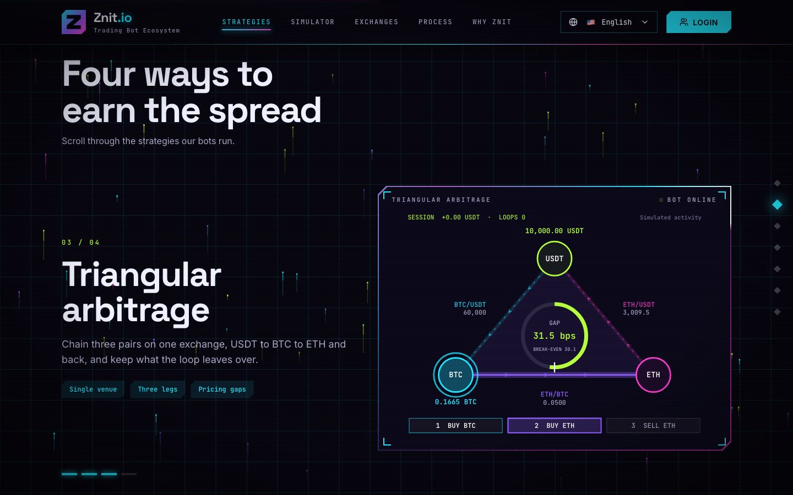 | 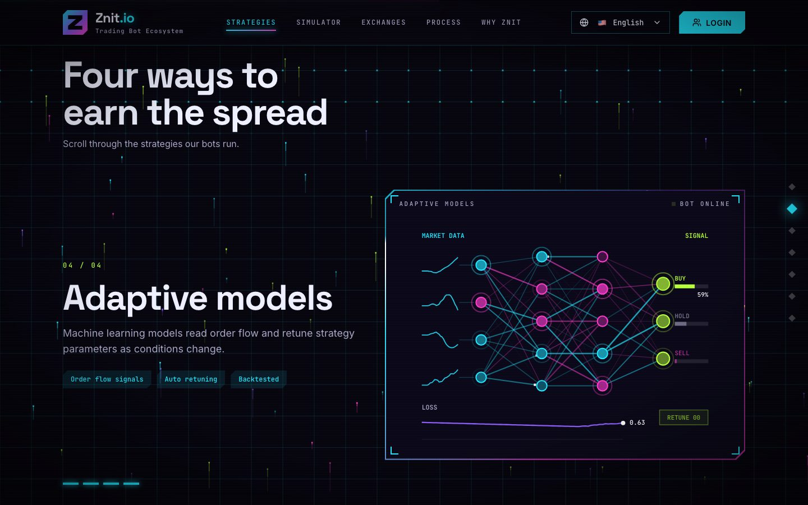 |

- `MarketMakerScene.tsx`: livro de ofertas, cotações do bot, takers, estoque e spread capturado.
- `ArbitrageScene.tsx`: duas corretoras, diferença em bps contra o ponto de equilíbrio das taxas, lucro líquido.
- `TriangularArb.tsx`: ciclo USDT, BTC, ETH, com medidor de diferença contra o equilíbrio, decisão de executar ou ignorar e as três pernas.
- `NeuralScene.tsx`: rede com pesos, ativações, probabilidades de BUY, HOLD e SELL e curva de erro com reajustes.

Todas usam `SceneCanvas` (`scene.tsx`). Os valores são ilustrativos e rotulados como simulados.

### 4. Simulador e 5. Onde nossos bots operam

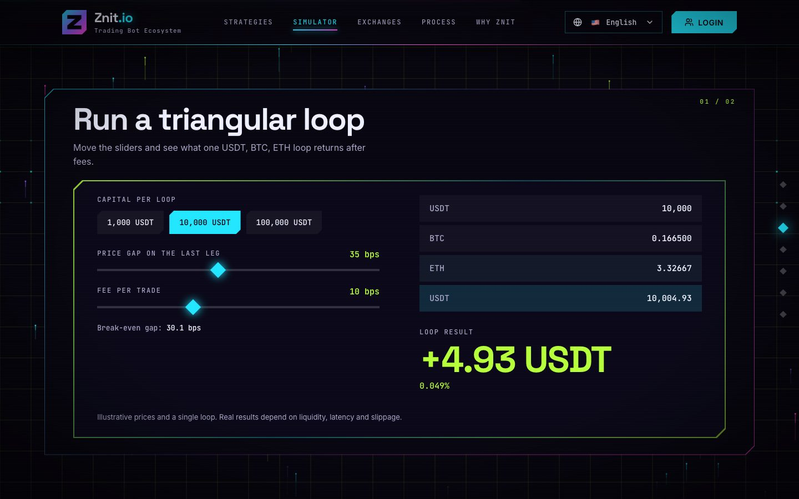

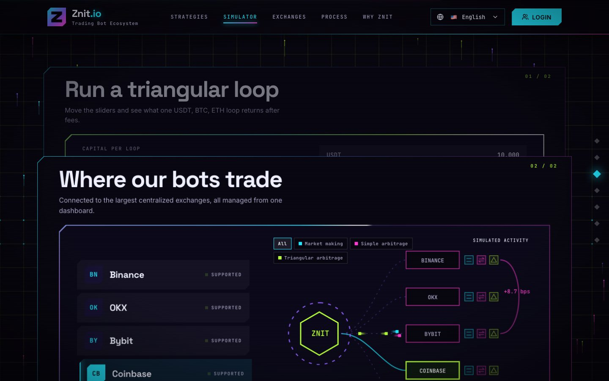

No desktop as duas seções formam **folhas empilhadas**: a segunda sobe por cima da primeira conforme o scroll (`.stack`, `.stack-pin`, `.stack-card` e a variável `--slide`, suavizada no loop de scroll). O simulador usa a mesma matemática da cena triangular (10 bps por operação). `Venues.tsx` é um canvas com os bots por exchange, filtros por estratégia e um log simulado.

### 6. Processo, 7. Por que Znit e CTA

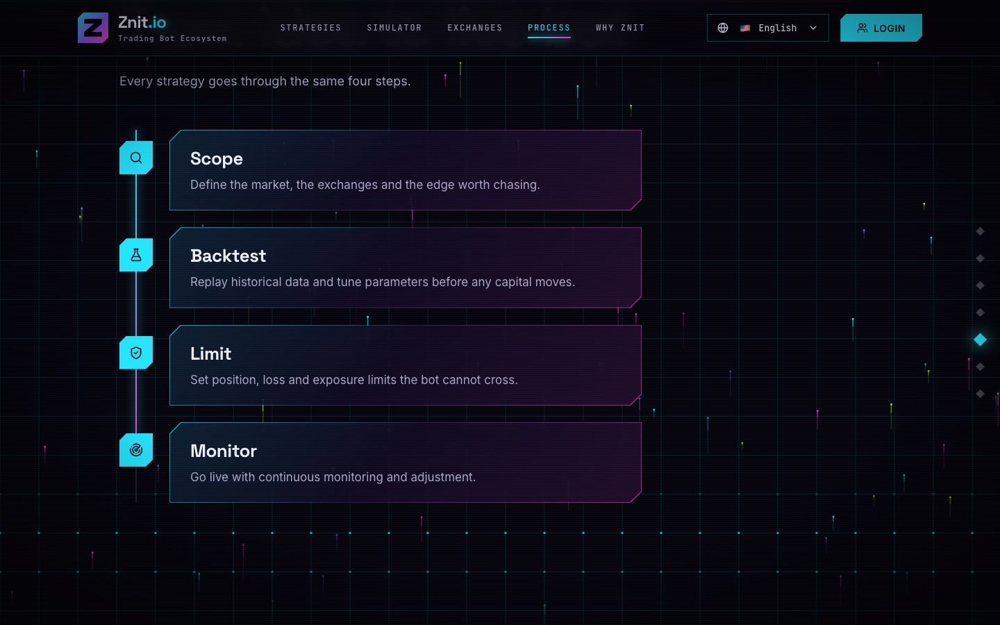

A linha do processo é desenhada durante o scroll e cada etapa acende em ordem. Em seguida vêm o bloco "por que Znit" (bento) e a chamada final.

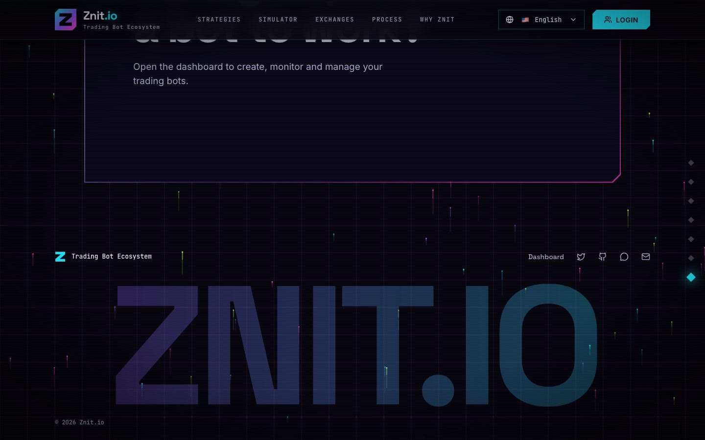

## Versão mobile

No mobile (`max-width: 900px`) a composição muda, sem remover elementos:

| Tela 1, o pitch | Tela 2, o núcleo ao vivo | Buraco negro | Cards empilhados |
| --- | --- | --- | --- |
| 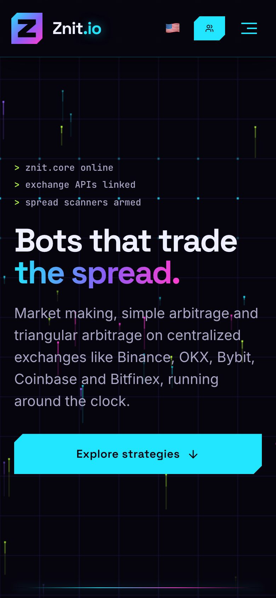 | 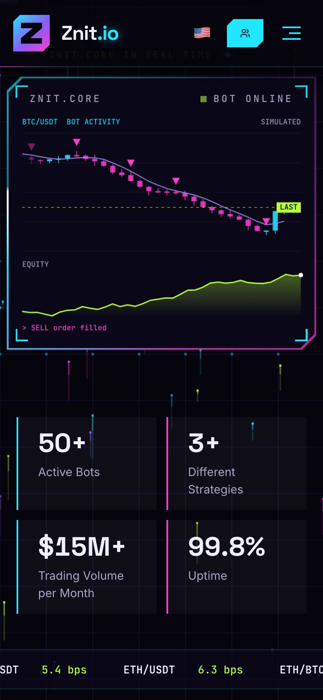 | 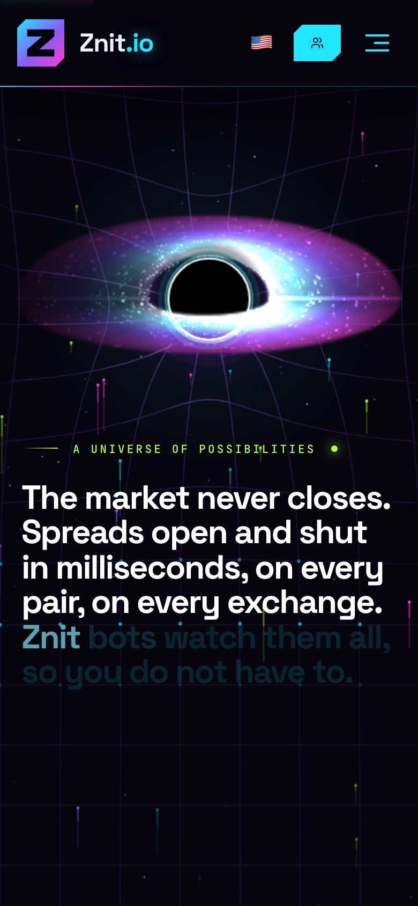 | 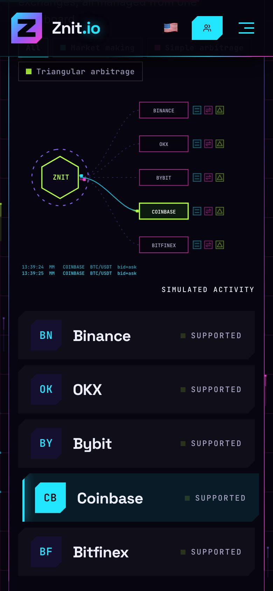 |

- O hero vira duas telas: a primeira com título, descrição e botão; a segunda com um rótulo verde (`landing.heroKicker`), o gráfico, os números e a faixa de bps.
- Os cards do simulador e das exchanges também empilham no mobile, com `position: sticky` no primeiro (veja o bloco "phones" em `landing.css`). A altura do primeiro card é medida em `LandingPage.tsx` (`--card-h`) para que um card mais alto que a tela fixe pela base.
- O efeito do mouse não existe em toque. O fundo ignora redimensionamentos só de altura (barra de URL) para não recriar os ticks durante o scroll.
- As cenas em canvas aumentam o texto quando aparecem pequenas (`tm` em `scene.tsx` e `Venues.tsx`).

## Sistema de design

Tokens (em `landing.css`, `:root`):

| Token | Valor | Uso |
| --- | --- | --- |
| `--zn-cy` | `#22e6ff` | ciano, destaque principal e bids |
| `--zn-mg` | `#ff3ccf` | magenta, vendas e asks |
| `--zn-vi` | `#8b5cf6` | violeta, malha e curvas |
| `--zn-lm` | `#b6ff3b` | lima, lucro, estado ativo |
| `--zn-ink`, `--zn-dim` | `#eef0ff`, `#a9a6c6` | texto principal e secundário |
| fundo | `#06040d` | base escura |

Blocos que se repetem:

- **`.zn-panel`**: painel chanfrado. O anel de 1 px é o próprio fundo do elemento e o preenchimento escuro está no `::before`. Classes irmãs: `.hud` (cantos), `.beam` (luz que percorre a borda via `@property --a`/`--o` e `conic-gradient`).
- **`.rv`**: revelação ao entrar na tela (`useReveal`). Respeita `prefers-reduced-motion`.
- **`Scramble` e `Counter`** (`fx.tsx`): texto que se decifra e números que contam.
- **`.mani-k`**: rótulo verde em mono com traço e ponto (usado acima do manifesto e no mobile do hero).
- Tipografia: títulos em Space Grotesk, dados em JetBrains Mono com `letter-spacing` aberto.
- Para japonês e chinês há ajustes específicos (`:lang(ja)`, `:lang(zh)`) em `landing.css`.

## Animação e performance

Padrões que valem para qualquer cena nova:

- **Canvas com espaço de design fixo** (480 x 360) escalado para o painel, DPR limitado (1,5 ou 2).
- **Pausar fora da tela**: `IntersectionObserver` mais a flag `active` (a estratégia está ativa) e `document.hidden`.
- **Movimento reduzido**: `reducedMotion()` e um quadro estático. `SceneCanvas` já faz isso, simulando alguns segundos antes de desenhar.
- **Tempo, não quadros**: movimento calculado com `dt` para ser igual em 60 e 120 Hz.
- **Sem gradientes por quadro no mobile** e poucos objetos por frame. O fundo evita alocar gradientes e agrupa linhas em `Path2D` por faixa de brilho.
- Loop de scroll único em `LandingPage.tsx` (`run()`), que calcula `--hp`, `--pg`, o progresso das estratégias, o deslize das folhas, a seção atual e o processo, sempre em um `requestAnimationFrame`.
- Classes `is-off` e `is-covered` pausam animações CSS de seções fora de vista ou cobertas.

### Fundo (`CyberBackground.tsx`)

Malha que cai em um poço gravitacional sob o cursor (com banda de brilho gradual), feixe de varredura, ticks subindo e tinta por capítulo (`tint`). Há um segundo poço, muito mais pesado, quando o buraco negro está na tela (`mass` em `lib/wells.ts`). A velocidade do poço do mouse tem teto (`MAX_SPEED`), para que sacudir o mouse não faça a malha saltar.

### Cometa nos painéis (`lib/lens.ts`)

Ao passar o mouse sobre um `.zn-panel`, um cometa acompanha o cursor (com inércia): cauda de íons afilada e cauda de poeira feita dos mesmos ticks do fundo. Atravessar uma camada (painel dentro de painel, ou outro card) provoca uma explosão no ponto de cruzamento. Ao sair do card, o cometa se solta com o impulso, abre um anel de dobra na borda e voa até sumir da tela, em um canvas fixo (`.lens-fly`). Enquanto voa, o cometa também deforma a malha do fundo: a posição da cabeça e de um rastro que vai se apagando é publicada em `src/lib/wells.ts` e o `CyberBackground` curva a grade ao redor desses pontos. `lens.ts` e `wells.ts` existem também no `tbot-dashboard`, mantenha as cópias iguais.

## Internacionalização

Idiomas: `en-US`, `en-GB`, `pt-BR`, `es-ES`, `fr-FR`, `de-DE`, `zh-CN`, `ja-JP`.

- **Textos**: `src/i18n/translations.ts`, um objeto por idioma com a mesma forma. Use `t('landing.hero.title')` do `useLanguage()`. Chave ausente cai em `en-US`.
- **URLs**: uma rota por idioma, definida em `src/i18n/locales.ts` (`/`, `/en-gb/`, `/pt-br/`, `/es/`, `/fr/`, `/de/`, `/zh/`, `/ja/`). Nas rotas da landing o idioma vem da URL; fora delas vale a preferência salva em `localStorage` (`preferred-language`).
- O `<html lang>`, o título e as meta tags são atualizados em runtime pelo `LanguageContext`.
- **Todo texto visível novo precisa de chave nos 8 idiomas**, inclusive rótulos dentro de canvas (as cenas usam `L('chave')` com o prefixo `landing.diagrams.`). Siglas e nomes de marca (BTC/USDT, Binance, OKX) não se traduzem.
- `translations.ts` é um objeto literal grande. Para alterações em lote, o jeito mais seguro foi transpilar o arquivo com `typescript` num script Node, alterar o objeto e gravar de volta com `JSON.stringify`.

## SEO

Páginas com JavaScript desligado e rastreadores precisam do conteúdo real, por isso o build gera HTML por idioma:

- `scripts/seo.cjs` (rodado após `craco build`) escreve `build/<idioma>/index.html` com o texto da página, `<title>`, descrição, canonical, `hreflang`, Open Graph, JSON-LD e um snapshot oculto do hero (visível só com `<noscript>`), e também o `robots.txt`.
- O `sitemap.xml` vem do `sitemap-webpack-plugin`, configurado em `craco.config.js` (somente em produção), com `hreflang` entre os idiomas.
- `netlify.toml` envia `X-Robots-Tag: noindex, nofollow` para `/dashboard-selector*`.
- `public/og-image.png` é a imagem de compartilhamento.
- Os `<script>` do rrweb em `public/index.html` estão marcados como "não editar nem remover". Não mexa.

## Rotas, login e dashboard

- Rotas: as 8 rotas de idioma renderizam `LandingPage`, mais `/dashboard-selector` (área de conta, fora da indexação).
- O botão de login abre um menu na navegação (`App.tsx`) que autentica no Cognito. A criação de conta está comentada.
- `DashboardSelector.tsx` leva o usuário aos aplicativos internos passando o token. Detalhes do fluxo local (cada app em uma porta, `localStorage` isolado por origem) em `LOCAL_ENVIRONMENT_FLOW.md`, e da infraestrutura de autenticação em `COGNITO_AUTH_IMPLEMENTATION.md`.
- `../tbot-dashboard` é o painel do portfólio, com o mesmo visual. Compartilha cópias de `CyberBackground.tsx` e `lib/lens.ts`.

## Receitas

### Mudar um texto

Edite a chave em `src/i18n/translations.ts`, em todos os idiomas. O texto no HTML pré-renderizado também vem desse arquivo.

### Adicionar uma estratégia ou trocar a cena de uma delas

1. Texto: `landing.strategies.items` (título, descrição, tags) nos 8 idiomas.
2. Cena: crie `NovaCena.tsx` em `components/landing/` usando `SceneCanvas`:

```tsx
import React from 'react';
import { useLanguage } from '../../i18n/LanguageContext';
import { SceneCanvas, SceneDraw, CY } from './scene';

const make = (): SceneDraw => {
  let clock = 0; // estado da cena vive no closure
  return (ctx, now, dt, ui) => {
    clock += dt;
    ui.text('TÍTULO', 20, 40, 10.5, CY, 'left', 700); // rótulos passam por ui.L('chave') para i18n
    // desenhe em um espaço de 480 x 360
  };
};

const NovaCena: React.FC<{ active?: boolean }> = ({ active }) => {
  const { t } = useLanguage();
  return <SceneCanvas make={make} active={active} label={t('landing.diagrams.altNova')} />;
};
export default NovaCena;
```

3. Exporte em `Diagrams.tsx` e inclua o componente na lista `DIAGRAMS` de `LandingPage.tsx` (a ordem é a das estratégias). Ajuste `--n` se mudar a quantidade.

### Adicionar uma seção

1. Crie o markup em `LandingPage.tsx` com um `id` e inclua o id em `SECTIONS` (e em `NAV_SECTIONS` de `App.tsx` se for aparecer no menu e na trilha).
2. Estilos em `landing.css`, com um bloco para `max-width: 900px`.
3. Textos nos 8 idiomas. Se a seção deve ser indexada, inclua o texto no snapshot de `scripts/seo.cjs`.

### Adicionar um idioma

1. `LangCode`, `LANG_PATH` e `HREFLANG` em `src/i18n/locales.ts`.
2. Um novo objeto em `translations.ts` com todas as chaves.
3. `NAMES` e `OG_LOCALE` em `scripts/seo.cjs`, e a bandeira e o nome na lista `getAvailableLanguages` de `src/i18n/LanguageContext.tsx`.
4. Se a escrita não usa espaços (como japonês e chinês), confira o `Manifesto.tsx`: ele segmenta por palavra com `Intl.Segmenter` quando o texto tem poucos espaços.

## Testar visualmente

Não há testes automatizados de interface. O fluxo usado no projeto é um script Playwright que sobe o dev server, rola até a seção e tira capturas. Exemplo mínimo:

```js
// shot.cjs: CHR=<caminho do headless_shell> node shot.cjs
const { chromium } = require('playwright');
(async () => {
  const b = await chromium.launch({ executablePath: process.env.CHR });
  const p = await (await b.newContext({ viewport: { width: 390, height: 844 }, isMobile: true, hasTouch: true })).newPage();
  await p.goto('http://localhost:3111/');
  await p.waitForTimeout(4000);
  await p.evaluate(() => {
    const el = document.getElementById('strategies');
    scrollTo(0, el.getBoundingClientRect().top + scrollY + 0.55 * (el.offsetHeight - innerHeight));
  });
  await p.waitForTimeout(2500);
  await p.screenshot({ path: 'strategies.png' });
  await b.close();
})();
```

```bash
BROWSER=none PORT=3111 yarn start          # em um terminal
node shot.cjs                              # em outro
pkill -f craco                             # ao terminar, não deixe o servidor rodando
```

Dicas: mate sempre o servidor anterior (um bundle antigo na mesma porta engana), espere "compiled successfully" e use `deviceScaleFactor: 2` para ver texto pequeno de canvas. As imagens deste README foram geradas assim, com `type: 'jpeg'`.

## Convenções e cuidados

- Rode `npx tsc --noEmit -p .` antes de subir alterações. Um erro de lint do CRA (por exemplo regra de ESLint inexistente em comentário) também derruba o dev server com tela de erro.
- Todo efeito visual precisa de versão para `prefers-reduced-motion` e não pode causar rolagem horizontal no mobile.
- Evite criar gradientes ou objetos por quadro em loops de animação, principalmente em canvas que rodam no mobile.
- Não use `!important` para vencer especificidade em `.zn-panel`. Os estilos do painel dependem de `::before` e `::after`, e `.zn-panel.tone-*` já resolve variações de cor.
- Texto novo sem chave nos 8 idiomas vai aparecer em inglês nos demais. Evite.
- Não edite nem remova os scripts do rrweb em `public/index.html`.
- O desvio de autenticação de desenvolvimento do dashboard (`../tbot-dashboard/src/AuthGuard.tsx`) e a pasta `build/` versionada de lá são do time do dashboard, não alterar daqui.
- `lib/lens.ts` e `CyberBackground.tsx` têm cópia no dashboard. Mudou em um, avalie copiar para o outro (o `CyberBackground` do landing tem a parte do buraco negro, `mass`, que o dashboard não usa).

## Deploy

Netlify: `npm run build` publica `build/`, com fallback `/* -> /index.html` (SPA). Confirme em produção que `/robots.txt` e `/sitemap.xml` respondem e que cada rota de idioma abre com o texto no HTML (visualizar código-fonte). O endereço do site vem de `SITE_URL`.

## Documentos relacionados

- `LOCAL_ENVIRONMENT_FLOW.md`: como o login passa entre as aplicações no ambiente local.
- `COGNITO_AUTH_IMPLEMENTATION.md`: autenticação Cognito, restrição de domínio e infraestrutura.
